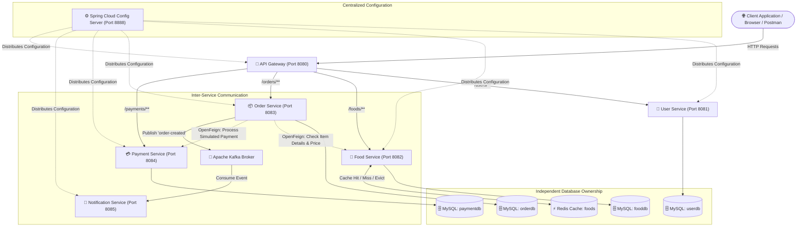
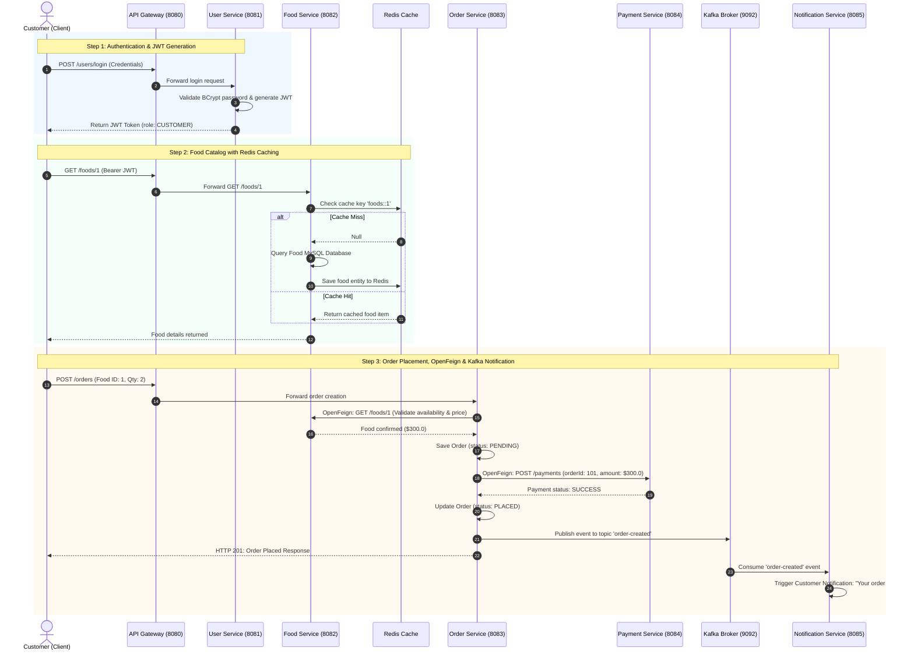

# Online Food Ordering & Delivery Management System

A production-grade, distributed microservices platform built using **Spring Boot 3**, **Spring Cloud (Config Server, API Gateway, OpenFeign)**, **Apache Kafka**, **Redis**, **Spring Security with JWT & RBAC**, and **MySQL**.

---

## 🏗️ System Architecture

The system is decomposed into domain-driven microservices with independent database ownership, centralized configuration, resilient service-to-service communication via OpenFeign, asynchronous messaging via Kafka, and caching via Redis.



---

## 🔄 End-to-End Order Execution Flow



---

## 🛠️ Technology Stack

| Component | Technology | Description |
| :--- | :--- | :--- |
| **Framework** | Spring Boot 3.3.4 | Core enterprise application framework |
| **Language** | Java 21 / 25 | Modern Java with records, virtual threads support |
| **API Gateway** | Spring Cloud Gateway | Unified routing and reverse proxy |
| **Config Server** | Spring Cloud Config Server | Centralized application configuration |
| **Inter-Service REST** | Spring Cloud OpenFeign | Declarative HTTP client for microservice orchestration |
| **Messaging** | Apache Kafka 3.7.0 | Event-driven architecture and asynchronous notifications |
| **In-Memory Cache** | Redis 7 & Spring Data Redis | High-speed cache for catalog read optimization and eviction |
| **Security** | Spring Security 6 & JJWT | Stateless authentication and Role-Based Access Control (RBAC) |
| **Persistence** | Spring Data JPA & Hibernate | ORM mapping and data access |
| **Database** | MySQL 8.0 | Relational database (dedicated schema per service) |
| **Containerization** | Docker & Docker Compose | Container orchestration for MySQL, Redis, and Kafka |

---

## 📋 Microservices & Port Allocations

| Service Name | Port | Database / Broker | Key Responsibilities |
| :--- | :--- | :--- | :--- |
| **API Gateway** | `8080` | - | Unified entry point; route resolution to backend services |
| **Config Server** | `8888` | Local Native Repository | Central configuration distribution |
| **User Service** | `8081` | MySQL: `userdb` | Customer/Admin registration, BCrypt password hashing, JWT issuance |
| **Food Service** | `8082` | MySQL: `fooddb` + Redis | Food catalog CRUD, Redis caching (`@Cacheable`, `@CacheEvict`) |
| **Order Service** | `8083` | MySQL: `orderdb` | Order placement, OpenFeign orchestration, Kafka event publishing |
| **Payment Service** | `8084` | MySQL: `paymentdb` | Simulated payment processing via OpenFeign integration |
| **Notification Service** | `8085` | Kafka Consumer | Asynchronous event processing for order confirmation notifications |

---

## 🚀 Getting Started

### Prerequisites
* Java 21+ installed
* Maven Wrapper (`mvnw.cmd` included)
* Docker Desktop installed and running

### Step 1: Start Infrastructure (MySQL, Redis, Kafka)
Run the provided Docker Compose manifest:
```bash
docker compose up -d
```
This spins up:
* **MySQL 8.0** on `localhost:3307` with pre-created databases (`userdb`, `fooddb`, `orderdb`, `paymentdb`)
* **Redis 7** on `localhost:6379`
* **Apache Kafka** on `localhost:9092`

Verify containers are running:
```bash
docker ps
```

---

### Step 2: Build the Project
Compile and run tests across all modules:
```bash
.\mvnw.cmd clean package
```

---

### Step 3: Run Microservices
Launch each service in sequence (Config Server first):

```powershell
# 1. Config Server (Port 8888)
.\mvnw.cmd spring-boot:run -pl config-server

# 2. User Service (Port 8081)
.\mvnw.cmd spring-boot:run -pl user-service

# 3. Food Service (Port 8082)
.\mvnw.cmd spring-boot:run -pl food-service

# 4. Payment Service (Port 8084)
.\mvnw.cmd spring-boot:run -pl payment-service

# 5. Order Service (Port 8083)
.\mvnw.cmd spring-boot:run -pl order-service

# 6. Notification Service (Port 8085)
.\mvnw.cmd spring-boot:run -pl notification-service

# 7. API Gateway (Port 8080)
.\mvnw.cmd spring-boot:run -pl api-gateway
```

---

## 🔑 Security & Role-Based Access Control (RBAC)

* **Public Endpoints**:
  * `POST /users/register` - Create account
  * `POST /users/login` - Authenticate and acquire JWT
  * `GET /foods/**` - Browse food catalog
* **CUSTOMER Permissions**:
  * Browse food items
  * `POST /orders` - Place orders
  * `GET /orders/customer/{id}` - View customer orders
* **ADMIN Permissions**:
  * `POST /foods` - Add food item
  * `PUT /foods/{id}` - Update food item & evict Redis cache
  * `DELETE /foods/{id}` - Delete food item & evict Redis cache
  * `DELETE /users/{id}` - Manage user accounts
* **Unauthorized Attempt**: Any request lacking required role returns `HTTP 403 Forbidden`.

---

## 🧪 Testing and Verification

Run automated tests across all microservices:
```powershell
.\mvnw.cmd test
```

### Manual Verification via cURL / Gateway:

1. **Register Customer**:
   ```powershell
   curl -X POST http://localhost:8080/users/register -H "Content-Type: application/json" -d '{"name":"Alice","email":"alice@example.com","password":"password123","phone":"9876543210","role":"CUSTOMER"}'
   ```

2. **Login & Obtain JWT**:
   ```powershell
   curl -X POST http://localhost:8080/users/login -H "Content-Type: application/json" -d '{"email":"alice@example.com","password":"password123"}'
   ```

3. **Verify Redis Cache Miss vs Hit**:
   ```powershell
   # 1st call -> Cache Miss (fetches from MySQL, caches in Redis)
   curl http://localhost:8080/foods/1

   # 2nd call -> Cache Hit (served instantly from Redis)
   curl http://localhost:8080/foods/1
   ```

4. **Verify HTTP 403 Forbidden**:
   ```powershell
   curl -i -X POST http://localhost:8080/foods -H "Authorization: Bearer <CUSTOMER_TOKEN>" -H "Content-Type: application/json" -d '{"foodName":"Burger","price":150.0,"category":"Fast Food","availability":true,"restaurantId":1}'
   # Returns 403 Forbidden
   ```

5. **Place Order**:
   ```powershell
   curl -X POST http://localhost:8080/orders -H "Content-Type: application/json" -d '{"customerId":1,"restaurantId":1,"items":[{"foodId":1,"quantity":2}]}'
   ```
   *Watch Order Service console for OpenFeign execution and Kafka event publishing.*
   *Watch Notification Service console for consumer receipt and simulated notification dispatch.*

---

## 👤 Author
* **Ayush Chaurasiya** - [GitHub: ayush-init](https://github.com/ayush-init)
* Project Repository: [https://github.com/ayush-init/Food-ordering.git](https://github.com/ayush-init/Food-ordering.git)
